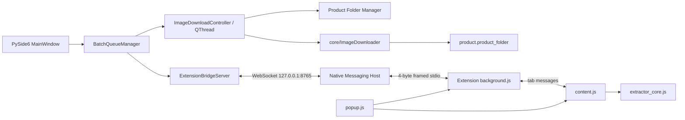

# Active Architecture

This document describes the only active runtime architecture. Historical Playwright/CDP extraction, direct Chrome WebSockets, and alternate batch protocols are not part of the application.

## System boundary



There is one active Shopee extraction implementation: `chrome_extension/extractor_core.js`. Python does not extract Shopee HTML, and the popup/background layers do not implement gallery algorithms.

## Automatic desktop flow

When the user pastes URLs and clicks **Bắt đầu tải ảnh**, the exact call path is:

1. `shopee_image_downloader.main.main()` creates `MainWindow`.
2. `MainWindow.handle_start_validation()` validates the output folder and calls `parse_url_lines()`.
3. It initializes table rows and calls `BatchQueueManager.start_batch()`.
4. `BatchQueueManager._process_current_item()` emits `item_started` and `send_open_product_requested` for exactly one item.
5. `MainWindow._on_queue_send_open_product()` creates the sole `open_product` command with `create_open_product_message()` and calls `ExtensionBridgeServer.send_message()`.
6. `ExtensionBridgeServer` sends the JSON text frame to the connected Native Host over the localhost WebSocket.
7. `NativeMessagingHost._on_ws_message_received()` relays the command to Chrome using Native Messaging framing.
8. `background.js` receives `open_product` in `handleNativeMessage()` and calls `handleOpenProductRequest()`.
9. `ensureActiveWorkerTab()` creates or reuses one foreground worker tab and navigates to the requested URL.
10. Chrome injects `extractor_core.js`, followed by `content.js`, as declared by `manifest.json`.
11. `content.js` calls `runProductExtractionLifecycle()`, which invokes `ShopeeExtractorCore.extractProductData()`.
12. A complete extraction is normalized by `buildProductSnapshot()` and emitted as `AUTHORITATIVE_PRODUCT_COMPLETE`.
13. `background.js` correlates the worker tab, product key, and request ID, then calls the only final-result builder, `sendCompleteProductToDesktop()`.
14. The `product_result` crosses Native Messaging, the Native Host WebSocket relay, `ExtensionBridgeServer._on_text_message()`, and `parse_bridge_product_data()`.
15. `MainWindow._on_bridge_product_received()` routes every session-known `request_id` to `BatchQueueManager`; stale, missing, or mismatched IDs cannot enter the batch pipeline.
16. The queue validates the authoritative image count, snapshots the product image list, enters `CREATING_FOLDER`, and emits one worker-pipeline request without advancing.
17. `ImageDownloadController` moves an `ImageDownloadWorker` to a dedicated `QThread`. In that thread, the desktop-owned Product Folder Manager creates the safe child directory under the selected output root.
18. The worker attaches the resulting `Path` to `BridgeProductData.product_folder` without changing the authoritative name, IDs, or image list. Its correlated `folder_ready` event moves the queue to `DOWNLOADING`.
19. In the same worker thread, `ImageDownloader` receives `product.images` unchanged and in order and writes only below that exact `product.product_folder`.
20. Correlated worker progress updates the table status (`Đang tải ảnh n/total`). Overall batch progress remains based only on terminal queue items.
21. The worker stores its terminal outcome, requests `QThread` shutdown, and the controller clears its worker/thread ownership before publishing `finished`, `failed`, or `cancelled` to the UI.
22. `BatchQueueManager.handle_download_result()` validates the request ID, product key, product name, image list, product folder, ordered per-image results, and totals. It marks the item `SUCCESS` or `COMPLETED_WITH_ERRORS`, then and only then advances to the next product. Controlled folder/downloader failures mark only that item `FAILED` and continue.

This is the single automatic batch flow. There is no `process_url` alias and no polling-based `RUN_FULL_SCAN` path.

## Manual extension flow

1. `popup.js:init()` locates the active Shopee tab.
2. `performExtraction()` sends `EXTRACT_PRODUCT_DATA` to `content.js`.
3. `content.js` calls `ShopeeExtractorCore.extractProductData()` and returns the display result to the popup.
4. **Kết nối Desktop** sends `CONNECT_DESKTOP` to `background.js`, which calls `chrome.runtime.connectNative()` and sends `connect_desktop` to the Native Host.
5. **Gửi sang ứng dụng** sends only the active tab ID and URL to `background.js`; it does not send a reconstructed product payload.
6. `background.js` requests `GET_COMPLETE_SNAPSHOT` from `content.js`.
7. `content.js:getCompleteSnapshotRPC()` returns its authoritative cached snapshot or invokes the same extractor core if required.
8. `background.js` calls the same `sendCompleteProductToDesktop()` used by the automatic path.
9. The result crosses the Native Host and desktop bridge. With no active correlated batch request, `MainWindow._on_bridge_product_received()` inserts or updates the row by `shop_id:item_id`, creates the Task 007A folder, and starts the same background downloader.

## Component responsibilities

| Component | Owns | Must not own |
|---|---|---|
| `MainWindow` | User input, folder selection, result presentation, signal wiring, desktop result/download orchestration | Shopee extraction, path-sanitization rules, blocking network calls |
| `BatchQueueManager` | FIFO state, transition guards, request/product/folder correlation, extraction timeout, progress, verification pause/resume, cancellation | Browser/tab control, DOM extraction, filesystem/network work |
| `core/image_downloader.py` | Ordered image HTTP requests, MIME/extension choice, bounded retry/timeout, atomic file commits, per-image/product results | Shopee discovery or extraction, Qt/UI state, product folder creation |
| `workers/image_download_worker.py` | One-product-at-a-time folder/download `QThread`, correlated progress/outcome context, cooperative cancellation, exact cleanup | Filename/MIME/retry policy, extraction |
| `storage/product_folder.py` | Windows-safe product folder naming, collision suffix, output-root validation and containment | Image downloading, duplicate-product semantics, UI presentation |
| `ExtensionBridgeServer` | Loopback WebSocket lifecycle, inbound validation, Qt signals | Shopee business extraction |
| Native Host | Native Messaging framing and localhost relay | Product construction, extraction, queue policy |
| `background.js` | Native connection, worker tab, correlation, timeout, canonical outbound product message | DOM/gallery extraction |
| `content.js` | Page lifecycle and extraction RPC boundary | Native transport, independent extractor |
| `extractor_core.js` | All Shopee product and gallery extraction | Desktop/native transport |
| `popup.js` | Manual UI and user actions | Authoritative product construction, direct extraction algorithm |

## Message ownership

| Message | Producer / owner | Consumer |
|---|---|---|
| `CONNECT_DESKTOP` | Popup | Background service worker |
| `GET_BRIDGE_STATUS` | Popup | Background service worker |
| `BRIDGE_STATUS_CHANGED` | Background service worker | Popup |
| `EXTRACT_PRODUCT_DATA` | Popup | Content script |
| `GET_COMPLETE_SNAPSHOT` | Background service worker | Content script |
| `AUTHORITATIVE_PRODUCT_COMPLETE` | Content script | Background service worker |
| `SEND_PRODUCT_TO_DESKTOP` | Popup | Background service worker |
| `connect_desktop` | Background service worker | Native Host |
| `bridge_status` | Native Host | Background service worker |
| `hello` | Native Host WebSocket client | Desktop bridge server |
| `hello_ack` | Desktop bridge server | Native Host |
| `open_product` | Desktop queue/UI | Background service worker |
| `process_progress` | Background service worker | Desktop queue |
| `process_error` | Background service worker | Desktop queue |
| `product_result` | `sendCompleteProductToDesktop()` | Desktop bridge/UI |
| `product_result_ack` | Desktop bridge server | Background service worker |
| `cancel_processing` | Desktop queue/UI | Background service worker |
| `batch_finished` | Desktop UI | Background service worker |
| `error` | Native Host or desktop validation boundary | Background service worker |

The Native Host relays messages between the two transport boundaries but does not rebuild or interpret product data.

## Task 010 batch lifecycle and correlation

Each queue item has one lifecycle. `COMPLETED_WITH_ERRORS` preserves Task 007B's partial-image result semantics and is terminal; it is not a second queue state system.

```text
PENDING
  → OPENING_PRODUCT
  → WAITING_EXTRACTION
  → CREATING_FOLDER
  → DOWNLOADING
  → SUCCESS | COMPLETED_WITH_ERRORS

Any active state → FAILED
Any non-terminal state during cancellation → CANCELLED
```

The queue has at most one current product. Product B's `open_product` is emitted only after Product A's download worker has produced a terminal result, its `QThread` has finished, controller-owned worker/thread references have been cleared, and Product A has been finalized.

`request_id` is mandatory for batch `product_result` events. Extraction progress and errors require the current request ID. Folder readiness, download progress, failure, cancellation, and completion additionally match product identity and the authoritative image list; download-phase events also match the exact product folder. Session-known stale request IDs remain classified as batch traffic after completion or cancellation and are ignored rather than reinterpreted as manual sends.

Overall progress is `terminal items / total items`. Terminal items are `SUCCESS`, `COMPLETED_WITH_ERRORS`, `FAILED`, and `CANCELLED`; a currently downloading product does not increment it. Current-product progress is kept separately in its table row as `Đang tải ảnh n/total`. Final summaries derive success, failure, and cancellation counts from the terminal item states.

Cancellation changes the queue to `CANCELLING`, prevents any new `open_product`, sends the existing Chrome cancellation message, and cooperatively signals an active worker. Pending inputs are marked `CANCELLED`. If extraction is still pending, the queue finalizes immediately and rejects later results. If a folder/download worker is active, batch completion waits for the worker's clean exit. The downloader checks cancellation between images and chunks, removes current `.part` files, and retains completed images.

Closing the application uses the same cooperative path. A close event is deferred while a worker is active and retried from the controller's `idle` signal, avoiding both an unbounded GUI-thread wait and destruction of a running `QThread`.

## Storage, downloader policy, and concurrency

`SettingsManager` persists only the selected output folder. `storage/product_folder.py` creates exactly one direct child for each successful item. It preserves Unicode, replaces Windows-invalid characters and ASCII controls, normalizes whitespace, protects reserved device names, falls back to `product_<shop_id>_<item_id>`, limits the component to 120 characters, and verifies resolved-path containment. If the primary title directory exists, the provisional Task 007A collision form is `<title> [<shop_id>-<item_id>]`; full duplicate semantics remain deferred to Task 012.

Task 007B accepts exactly `BridgeProductData.images`; it never discovers, filters, sorts, or re-extracts media. The only destination is the existing validated `BridgeProductData.product_folder` created by Task 007A. Controlled filenames use the one-based input index with `max(2, digits(total))` padding (`01`, `09`, `001`, `120`). URL path fragments never become filenames.

The response `Content-Type` selects `.jpg`, `.png`, `.webp`, `.gif`, `.bmp`, `.tif`, or `.avif` when supported. Missing or `application/octet-stream` content types fall back to a recognized body signature, then an allow-listed URL suffix, then `.jpg` for the extension-less Shopee CDN case. Explicit HTML/JSON/unsupported MIME responses and empty bodies fail without a final image file.

Every request uses minimal `User-Agent` and `Accept: image/*` headers. Central defaults are a 10-second connect bound, 15-second read bound, 30-second overall attempt bound, three total attempts, and 0.25-second incremental backoff. Timeouts, connection failures, HTTP 429, and HTTP 5xx are retryable; permanent HTTP errors and invalid media responses are not.

Each transfer writes `<sequential-name>.<ext>.part`, flushes and closes it, then atomically replaces an empty/missing final path. Handled failures and cancellation remove the current `.part`. A non-empty exact target is preserved and reported as `SKIPPED_EXISTING`; broader duplicate/re-download policy remains Task 012.

`ProductDownloadResult` stores `total`, `successful`, `failed`, `skipped`, and ordered per-image results (`index`, `source_url`, `target_path`, `status`, `attempts`, `error`) on the existing product model. One failed image leaves prior valid files in place and produces `COMPLETED_WITH_ERRORS`; it does not abort the remaining image URLs or the following product.

Product-folder creation and the blocking standard-library HTTP/file loop run only inside `ImageDownloadWorker` on a dedicated `QThread`. Products remain sequential: extraction A → folder A → all downloads A → worker cleanup A → terminal item A → extraction B. Retry/backoff remains the bounded Task 007B per-image policy; Task 010 adds no generalized retry framework. The Qt GUI thread performs only validation, orchestration, and presentation.

## Required generated runtime artifact

`native_host/dist/shopee_native_host.exe` is a generated PyInstaller artifact but may be the executable referenced by the installed Native Messaging manifest. It is intentionally preserved. `native_host/shopee_native_host.spec` and the build/install/uninstall scripts are also preserved.
