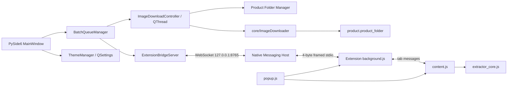

# Active Architecture

This document describes the only active runtime architecture. Historical Playwright/CDP extraction, direct Chrome WebSockets, and alternate batch protocols are not part of the application.

## System boundary



There is one active Shopee extraction implementation: `chrome_extension/extractor_core.js`. Python does not extract Shopee HTML, and the popup/background layers do not implement gallery algorithms.

## Automatic desktop flow

When the user pastes URLs and clicks **Bắt đầu tải ảnh**, the exact call path is:

1. `shopee_image_downloader.main.main()` creates `MainWindow`.
2. `MainWindow.handle_start_validation()` validates the output folder and calls `parse_url_lines()`.
3. It initializes table rows and calls `BatchQueueManager.start_batch()`.
4. `BatchQueueManager._process_current_item()` emits `item_started` and `send_open_product_requested` for exactly one item.
5. `MainWindow._on_queue_send_open_product()` creates the sole `open_product` command with `create_open_product_message()` and calls `ExtensionBridgeServer.send_message()`.
6. `ExtensionBridgeServer` sends the JSON text frame to the connected Native Host over the localhost WebSocket.
7. `NativeMessagingHost._on_ws_message_received()` relays the command to Chrome using Native Messaging framing.
8. `background.js` receives `open_product` in `handleNativeMessage()` and calls `handleOpenProductRequest()`.
9. `ensureActiveWorkerTab()` creates or reuses one foreground worker tab and navigates to the requested URL. Task 015B deliberately retains this real-tab architecture; it does not add headless, hidden-browser, CDP, Selenium, or zero-tab extraction.
10. Chrome injects `extractor_core.js`, followed by `content.js`, as declared by `manifest.json`.
11. `content.js` calls `runProductExtractionLifecycle()`, which invokes `ShopeeExtractorCore.extractProductData()`.
12. A complete extraction is normalized by `buildProductSnapshot()` and emitted as `AUTHORITATIVE_PRODUCT_COMPLETE`.
13. `background.js` correlates the worker tab, product key, and request ID, then calls the only final-result builder, `sendCompleteProductToDesktop()`.
14. The `product_result` crosses Native Messaging, the Native Host WebSocket relay, `ExtensionBridgeServer._on_text_message()`, and `parse_bridge_product_data()`.
15. `MainWindow._on_bridge_product_received()` routes every session-known `request_id` to `BatchQueueManager`; stale, missing, or mismatched IDs cannot enter the batch pipeline.
16. The queue validates the authoritative image count and canonical `product_key` (`shop_id:item_id`). If another distinct queue item already completed that key successfully in the current batch, the later item becomes terminal `SKIPPED_DUPLICATE`, reuses the successful result/folder reference, and starts no worker. Failed or partial earlier items are not reusable.
17. A non-duplicate item snapshots the product image list, enters `CREATING_FOLDER`, and emits one worker-pipeline request without advancing.
18. `ImageDownloadController` moves an `ImageDownloadWorker` to a dedicated `QThread`. In that lifecycle, the desktop-owned Product Folder Manager first resolves any exact immediate-child `.shopee-product-id` claim, otherwise validates the app-local product-folder registry, or creates a safe child. The optional marker and registry policy is applied before publishing the folder.
19. The worker attaches the resulting `Path` to `BridgeProductData.product_folder` without changing the authoritative name, IDs, or image list. Its correlated `folder_ready` event moves the queue to `DOWNLOADING`.
20. `ImageDownloader` receives `product.images` unchanged and in order, runs at most four image transfers concurrently, and writes only below that exact `product.product_folder`. Result slots and filenames remain tied to the authoritative input index rather than completion order.
21. Correlated worker progress updates the table status (`Đang tải ảnh n/total`). Overall batch progress remains based only on terminal queue items.
22. After the final `ProductDownloadResult` exists, the worker optionally builds Task 013 metadata from the unchanged product snapshot and exact ordered download results, then atomically replaces `<product_folder>/product.json`. The UI defaults this export off and never deletes an existing file when it is off.
23. The worker stores its terminal outcome, requests `QThread` shutdown, and the controller clears its worker/thread ownership before publishing `finished`, `failed`, or `cancelled` to the UI.
24. `BatchQueueManager.handle_download_result()` validates the request ID, product key, product name, image list, product folder, ordered per-image results, and totals. It marks the item `SUCCESS` or `COMPLETED_WITH_ERRORS`, then and only then advances to the next product. Controlled folder/downloader/metadata failures mark only that item `FAILED` and continue.

This is the single automatic batch flow. There is no `process_url` alias and no polling-based `RUN_FULL_SCAN` path.

## Manual extension flow

1. `popup.js:init()` locates the active Shopee tab.
2. `performExtraction()` sends `EXTRACT_PRODUCT_DATA` to `content.js`.
3. `content.js` calls `ShopeeExtractorCore.extractProductData()` and returns the display result to the popup.
4. **Kết nối Desktop** sends `CONNECT_DESKTOP` to `background.js`, which calls `chrome.runtime.connectNative()` and sends `connect_desktop` to the Native Host.
5. **Gửi sang ứng dụng** sends only the active tab ID and URL to `background.js`; it does not send a reconstructed product payload.
6. `background.js` requests `GET_COMPLETE_SNAPSHOT` from `content.js`.
7. `content.js:getCompleteSnapshotRPC()` returns its authoritative cached snapshot or invokes the same extractor core if required.
8. `background.js` calls the same `sendCompleteProductToDesktop()` used by the automatic path.
9. The result crosses the Native Host and desktop bridge. With no active correlated batch request, `MainWindow._on_bridge_product_received()` inserts or updates the row by `shop_id:item_id`, creates/reuses the Task 007A/012 folder, and starts the same background folder/download/metadata worker used by the automatic flow.

## Component responsibilities

| Component | Owns | Must not own |
|---|---|---|
| `MainWindow` | User input, folder selection, presentation binding, signal wiring, desktop result/download orchestration | Shopee extraction, path-sanitization rules, blocking network calls, UI-derived business state |
| `ui/presentation.py` | Canonical Vietnamese `ItemState` labels, status tones, result counts, and terminal-state batch-summary formatting | Queue transitions, retry/duplicate policy, product identity, downloader results |
| `ui/theme.py` | Dark/light semantic palettes, application QSS/palette, live toggle state, and `QSettings` persistence | Queue, bridge, download, extraction, or product state |
| `BatchQueueManager` | FIFO state, transition guards, request/product/folder correlation, same-batch successful-product registry, extraction timeout, cooperative user/verification pause-resume, progress, cancellation | Browser/tab control, DOM extraction, filesystem/network work |
| `core/image_downloader.py` | Bounded concurrent image HTTP requests, authoritative index/MIME/extension choice, bounded retry/timeout, atomic file commits, ordered per-image/product results | Shopee discovery or extraction, Qt/UI state, product folder creation |
| `core/product_metadata.py` | Pure metadata construction, portable relative image paths, UTF-8 JSON schema, atomic `product.json` replacement | Product identity ownership, downloading, folder naming, UI orchestration |
| `workers/image_download_worker.py` | One-product-at-a-time folder/download/optional-metadata lifecycle, correlated progress/outcome context, cooperative pause/cancellation, exact cleanup | Filename/MIME/retry policy, extraction |
| `storage/product_folder.py` | Windows-safe naming, marker/registry resolution and collision policy, output-root validation and containment | Image downloading, same-batch queue semantics, UI presentation |
| `storage/product_registry.py` | Atomic app-local mapping from normalized output root plus product key to one relative immediate-child folder | Product metadata, image discovery, adoption of unsafe/mismatched folders |
| `ExtensionBridgeServer` | Loopback WebSocket lifecycle, inbound validation, Qt signals | Shopee business extraction |
| Native Host | Native Messaging framing and localhost relay | Product construction, extraction, queue policy |
| `background.js` | Native connection, worker tab, correlation, timeout, canonical outbound product message | DOM/gallery extraction |
| `content.js` | Page lifecycle and extraction RPC boundary | Native transport, independent extractor |
| `extractor_core.js` | All Shopee product and gallery extraction | Desktop/native transport |
| `popup.js` | Manual UI and user actions | Authoritative product construction, direct extraction algorithm |

## Message ownership

| Message | Producer / owner | Consumer |
|---|---|---|
| `CONNECT_DESKTOP` | Popup | Background service worker |
| `GET_BRIDGE_STATUS` | Popup | Background service worker |
| `BRIDGE_STATUS_CHANGED` | Background service worker | Popup |
| `EXTRACT_PRODUCT_DATA` | Popup | Content script |
| `GET_COMPLETE_SNAPSHOT` | Background service worker | Content script |
| `AUTHORITATIVE_PRODUCT_COMPLETE` | Content script | Background service worker |
| `SEND_PRODUCT_TO_DESKTOP` | Popup | Background service worker |
| `connect_desktop` | Background service worker | Native Host |
| `bridge_status` | Native Host | Background service worker |
| `hello` | Native Host WebSocket client | Desktop bridge server |
| `hello_ack` | Desktop bridge server | Native Host |
| `open_product` | Desktop queue/UI | Background service worker |
| `process_progress` | Background service worker | Desktop queue |
| `process_error` | Background service worker | Desktop queue |
| `product_result` | `sendCompleteProductToDesktop()` | Desktop bridge/UI |
| `product_result_ack` | Desktop bridge server | Background service worker |
| `cancel_processing` | Desktop queue/UI | Background service worker |
| `batch_finished` | Desktop UI | Background service worker |
| `error` | Native Host or desktop validation boundary | Background service worker |

The Native Host relays messages between the two transport boundaries but does not rebuild or interpret product data.

## Task 010 batch lifecycle and correlation

Each queue item has one lifecycle. `COMPLETED_WITH_ERRORS` preserves Task 007B's partial-image result semantics and is terminal; it is not a second queue state system.

```text
PENDING
  → OPENING_PRODUCT
  → WAITING_EXTRACTION
  → WAITING_RETRY → OPENING_PRODUCT (transient extraction failure only)
  → CREATING_FOLDER
  → DOWNLOADING
  → SUCCESS | COMPLETED_WITH_ERRORS

OPENING_PRODUCT | WAITING_EXTRACTION
  → SKIPPED_DUPLICATE (a different queue item already succeeded for this product_key)

Any active state → FAILED
Any non-terminal state during cancellation → CANCELLED
```

The queue has at most one current product. Product B's `open_product` is emitted only after Product A's download worker has produced a terminal result, its `QThread` has finished, controller-owned worker/thread references have been cleared, and Product A has been finalized.

The queue-level lifecycle additionally has `PAUSE_REQUESTED` and `PAUSED_USER` states. A pause request is cooperative: an active extraction may reach its correlated result, active image submissions drain, and a terminal product may reach the between-products boundary, but no new product or image is started. Resume continues the same logical item. Cancellation remains available in both pause states and wakes a paused worker before shutdown.

`request_id` is mandatory for batch `product_result` events. Extraction progress and errors require the current request ID. Each automatic product retry creates a new transport request ID while retaining the same `QueueItem`, input URL, row, and ordering. The prior IDs remain session-known but no longer current, so late progress, errors, or results from an earlier attempt are ignored rather than completing a newer attempt or being reinterpreted as a manual send. Folder readiness, download progress, failure, cancellation, and completion additionally match product identity and the authoritative image list; download-phase events also match the exact product folder.

Overall progress is `terminal items / total items`. Terminal items are `SUCCESS`, `SKIPPED_DUPLICATE`, `COMPLETED_WITH_ERRORS`, `FAILED`, and `CANCELLED`; a currently downloading product does not increment it. Current-product progress is kept separately in its table row as `Đang tải ảnh n/total`. Final summaries derive downloaded-success, duplicate, failure, and cancellation counts from the terminal item states.

## Task 014/015C presentation ownership

`MainWindow` renders the queue and worker models but does not infer lifecycle state from widget text. `ui/presentation.py` is the single presentation mapping for real `ItemState` values (`PENDING` through terminal states), restrained visual tones, structured image availability, and terminal-state summary text. Request-ID/product-key row indexes remain presentation correlations only; the queue and product models remain authoritative.

`ui/theme.py` owns the complete dark/light Qt palette and generated QSS. Normal labels and section titles are transparent; cards, inputs, tables, buttons, and the connection badge own their visual surfaces. `ThemeManager` applies the remembered `appearance/theme` value before the window is shown, toggles the application stylesheet live, and stores only `dark` or `light` through `QSettings`. Theme changes re-resolve semantic result-cell colors but never mutate the queue, current item, progress, URL model, result rows, checkbox values, or bridge connection property.

The action contract uses Start, Cancel, and one state-aware Pause button. It reads `Tạm dừng` while running, `Đang tạm dừng...` while reaching a safe boundary, `Tiếp tục` during a user pause, and `Tiếp tục sau xác minh` during verification. `IDLE` restores Start and disables Pause/Cancel; cancellation stays available while paused. URL input, output selection, and both optional-export checkboxes are locked while the queue or product worker is active and restored after completion/cancellation, so a second batch can reuse the same window. The default 900×860 layout and initial 600:200 vertical splitter allocation give the URL grid about 200 px of visible height (roughly 2.5 times the former 82 px editor), while the tested 620×480 minimum remains resizable and usable.

`BatchQueueManager.item_image_progress` exposes already-validated per-image counters independently of overall terminal-item progress. The worker/controller `metadata_started` signal and `BatchQueueManager.handle_metadata_started()` expose the existing `product.json` phase as the current item's presentation stage without adding an item state or changing metadata behavior. Final summaries consume the emitted `QueueItem` snapshots, never table cell strings.

Cancellation changes the queue to `CANCELLING`, prevents any new `open_product`, sends the existing Chrome cancellation message, and cooperatively signals an active worker. Pending inputs are marked `CANCELLED`. If extraction is still pending, the queue finalizes immediately and rejects later results. If a folder/download worker is active, batch completion waits for the worker's clean exit. The downloader checks cancellation between images and chunks, removes current `.part` files, and retains completed images.

Closing the application uses the same cooperative path. A close event is deferred while a worker is active and retried from the controller's `idle` signal, avoiding both an unbounded GUI-thread wait and destruction of a running `QThread`.

## Task 011 error and retry policy

`core/error_policy.py` is the canonical desktop policy. `AppError` retains the existing error code, category, stage, Vietnamese user message, technical message, original exception type when available, retryability, and bounded `Retry-After` value. The categories are `TRANSIENT`, `PERMANENT`, `USER_ACTION_REQUIRED`, `CANCELLED`, and `INTERNAL`; stages are `VALIDATION`, `EXTRACTION`, `FOLDER`, `DOWNLOAD`, `METADATA`, `PROTOCOL`, and `CANCEL`. Unknown codes default to `INTERNAL`, and protocol integrity/version/payload failures are never ordinary network retries.

Existing extension/desktop codes are classified rather than renamed. `PRODUCT_TIMEOUT` and the desktop `TIMEOUT`, network interruption, connection reset, and temporary bridge loss are transient. `NOT_FOUND`, invalid URLs/output paths, folder containment failures, permission errors, disk full, unsupported responses, and permanent HTTP responses are permanent. `VERIFICATION_REQUIRED` is user-action-required, and `CANCELLED` remains cancellation.

Product opening/extraction uses a 9,000 ms per-attempt timeout and three total attempts. After transient failure of attempts one and two, `BatchQueueManager` enters the existing item's `WAITING_RETRY` state and schedules non-blocking one-second then two-second single-shot Qt timers. The maximum modeled failing-product wait is therefore 30 seconds before transport overhead (9 + 1 + 9 + 2 + 9), down from about 108 seconds under the prior 35-second guard. Exhaustion fails that product and continues the queue. Permanent/internal/protocol failures fail immediately. Folder/download failure never restarts the whole product, so Task 007B's per-image retries cannot multiply with product retries and a partial image result retains `COMPLETED_WITH_ERRORS` semantics.

Verification is a pause, not an automatic retry: the extension changes the request to `PAUSED_VERIFICATION` and disarms its attempt timeout; the desktop stops its extraction timer and waits for the user to verify in Chrome. Resume preserves the same logical item and attempt count but creates one fresh transport request ID before redispatch, so a delayed pre-verification result cannot complete the resumed generation. Cancellation or application close stops extraction/retry timers, so a deferred callback cannot reopen the product.

User-facing mappings include `Không tìm thấy sản phẩm.`, `Hết thời gian chờ Shopee.`, `Không thể tạo thư mục sản phẩm.`, `Không có quyền ghi vào thư mục đầu ra.`, `Không đủ dung lượng ổ đĩa.`, and `Shopee yêu cầu xác minh trên Chrome.` Technical details are logged with request ID, queue row, attempt, error code/category, and stage; cookies, credentials, tokens, and passwords are not logged.

## Storage, downloader policy, and concurrency

`SettingsManager` persists only the selected output folder. `storage/product_folder.py` resolves exactly one managed direct child by canonical `product_key = shop_id:item_id`. It preserves Unicode, replaces Windows-invalid characters and ASCII controls, normalizes whitespace, protects reserved device names, falls back to `product_<shop_id>_<item_id>`, limits the component to 120 characters, and verifies resolved-path containment.

The UI exposes independent `product.json` and `.shopee-product-id` export choices, both off by default. Turning either option off prevents a new write but never removes an existing file. When enabled, the marker is `<product_folder>/.shopee-product-id`, contains only the canonical key as UTF-8 text, and is committed atomically through a same-directory temporary file and `replace`.

Marker evidence has precedence over the app-local registry. Discovery scans immediate output-root children only, rejects unsafe symlink/reparse containment, reuses one exact marker claim, and treats multiple exact claims as permanent `MULTIPLE_PRODUCT_FOLDERS`. When no marker claims the key, `ProductIdentityRegistry` validates a stored mapping as one existing, contained, non-reparse immediate child whose marker is absent or agrees. Corrupt registry data and stale/unsafe/conflicting targets are ignored or removed without adopting them. The Windows default is `%LOCALAPPDATA%\ShopeeImageDownloader\product-folders.json`; writes are flush/`fsync` plus atomic replace.

An unmarked same-title legacy directory with no valid registry mapping is ownership-unknown and is never guessed or overwritten; the manager uses `<title> [<shop_id>-<item_id>]` with deterministic numbered fallback. A new marker-free folder is usable only after its registry mapping is committed; on registry failure an empty new folder is removed and the folder stage fails. If marker export is enabled, the marker itself proves ownership and a registry write failure is non-fatal. `product.json` remains informational and never establishes identity.

Task 007B accepts exactly `BridgeProductData.images`; it never discovers, filters, sorts, or re-extracts media. The only destination is the existing validated `BridgeProductData.product_folder` created by Task 007A. Controlled filenames use the one-based input index with `max(2, digits(total))` padding (`01`, `09`, `001`, `120`). URL path fragments never become filenames.

The response `Content-Type` selects `.jpg`, `.png`, `.webp`, `.gif`, `.bmp`, `.tif`, or `.avif` when supported. Missing or `application/octet-stream` content types fall back to a recognized body signature, then an allow-listed URL suffix, then `.jpg` for the extension-less Shopee CDN case. Explicit HTML/JSON/unsupported MIME responses and empty bodies fail without a final image file.

Every request uses minimal `User-Agent` and `Accept: image/*` headers. Central defaults are a 10-second connect bound, 15-second read bound, 30-second overall attempt bound, three total attempts, and 0.25/0.5-second bounded backoff. Timeouts, connection failures, HTTP 429, and HTTP 5xx are retryable; HTTP 400/401/403/404 and other non-429 4xx responses, invalid media responses, permission failures, and disk-full writes are not. A valid HTTP 429 `Retry-After` delta/date is respected but clamped to 30 seconds; otherwise normal backoff applies.

Each transfer writes `<sequential-name>.<ext>.part`, flushes and closes it, then atomically replaces an empty/missing final path. Handled failures and cancellation remove the current `.part`. A non-empty exact target is preserved and reported as `SKIPPED_EXISTING`; the queue/storage layers own Task 012 product-level identity and reuse decisions.

Cross-run marker or validated-registry reuse still invokes this one downloader. Therefore a complete historical folder preserves valid existing targets as `SKIPPED_EXISTING`, while a partial folder preserves those targets and completes missing or zero-byte targets under the existing MIME/filename policy. Image count, title, folder name, URL equality, and image URL equality never establish product identity.

`ProductDownloadResult` stores `total`, `successful`, `failed`, `skipped`, and ordered per-image results (`index`, `source_url`, `target_path`, `status`, `attempts`, `error`) on the existing product model. One failed image leaves prior valid files in place and produces `COMPLETED_WITH_ERRORS`; it does not abort the remaining image URLs or the following product.

Product-folder creation and the blocking standard-library HTTP/file work run outside the GUI thread under the `ImageDownloadWorker` lifecycle. Products remain strictly sequential: extraction A → folder A → all downloads A → worker cleanup A → terminal item A → extraction B. Within one product, a bounded executor permits at most four active image transfers. It stops submitting at a pause/cancel boundary, drains active work for pause, and waits/cancels cleanly on terminal shutdown; `.part` ownership remains unique per authoritative index. Image backoff never blocks the GUI, and product backoff is event-driven on the Qt loop. Permission/disk-full failures retain completed files and continue the batch safely.

## Task 012 identity and duplicate policy

`request_id` and `product_key` remain different identities. A request ID belongs to one transport attempt; an automatic Task 011 retry generates another request ID for the same logical queue item. A product key is persistent Shopee identity. Retrying an item is never classified as a duplicate.

The queue keeps one batch-local registry containing only fully successful, reusable product results. A later distinct input resolving to the same key becomes `SKIPPED_DUPLICATE`, retains its own queue row/request accounting, reuses the successful folder/result reference, and starts no second download. `FAILED` and `COMPLETED_WITH_ERRORS` results do not enter that registry, so a later item may process normally. Cross-run discovery is intentionally different: finding a marker-owned folder reuses the folder but invokes the downloader so incomplete historical downloads can heal.

Manual Extension → Desktop sends continue to update table rows by product key and use the same Product Folder Manager and downloader. They do not mutate an active automatic queue and do not create a second marker- or registry-owned folder for an existing product.

## Task 013 product metadata

When `product.json` export is enabled, every automatic or manual managed worker lifecycle that reaches a final `ProductDownloadResult` writes exactly `<product_folder>/product.json`. When disabled, the worker skips this stage and leaves any existing metadata untouched. `build_product_metadata()` uses the authoritative `BridgeProductData.images` order and the existing `ProductDownloadResult`; it never scans the directory or changes the product model. The automatic queue snapshots its logical input URL into `BridgeProductData.input_url`, while a genuinely unavailable manual input URL is serialized as JSON `null`.

Schema version 1 contains `product_name`, `shop_id`, `item_id`, canonical `product_key`, `source_url`, authoritative `image_count`, ordered `images`, `download`, and a small product `status` (`success` or `partial`). Each image entry contains `index`, `source_url`, portable `local_file`, and `status` (`success`, `failed`, or `skipped_existing`). Download counters retain the current-run downloader semantics: `successful` means newly written, while `skipped` means an existing usable target.

```json
{
  "schema_version": 1,
  "product_name": "Túi đựng đồ du lịch",
  "shop_id": "123",
  "item_id": "456",
  "product_key": "123:456",
  "source_url": "https://shopee.vn/example-i.123.456",
  "image_count": 2,
  "images": [
    {
      "index": 1,
      "source_url": "https://images.example/1",
      "local_file": "01.webp",
      "status": "success"
    },
    {
      "index": 2,
      "source_url": "https://images.example/2",
      "local_file": "02.jpg",
      "status": "skipped_existing"
    }
  ],
  "download": {
    "total": 2,
    "successful": 1,
    "failed": 0,
    "skipped": 1
  },
  "status": "success"
}
```

Serialization is UTF-8 with readable Unicode, two-space indentation, a trailing newline, flush/`fsync`, and same-directory `product.json.tmp` → atomic replace. Reprocessing a marker-owned folder replaces the one current metadata file, so title, source URL, image list, and current-run counters can change without renaming the folder or deleting stale images. A same-batch `SKIPPED_DUPLICATE` starts no worker and therefore performs no second metadata write.

`METADATA_WRITE_ERROR` is a permanent `METADATA`-stage Task 011 error. It reports `Không thể ghi thông tin sản phẩm.`, retains technical details in logs, leaves completed images and any prior valid `product.json` intact, cleans the temporary file where safe, and continues automatic batch accounting through the existing failure path. Metadata stores no cookies, credentials, headers, Chrome profile/extension details, output root, product-folder path, or absolute image paths.

## Extension identity and Windows release artifacts

`chrome_extension/manifest.json` is the sole canonical release identity source. Its `key` is a public SPKI DER value encoded as Base64; Chromium hashes those DER bytes with SHA-256, uses the first 128 bits, and maps hexadecimal nibbles `0-f` to `a-p`. This deterministically produces `bhbnfalghoklngoohdpnjedcdcplbjhm` regardless of extension path or developer account. No private key is required or retained for the unpacked release.

`build_support/extension_identity.py` performs the independent build/test derivation. The development Native Messaging template contains an origin placeholder; `native_host/build_host.ps1` resolves it from the keyed manifest and then fails unless the generated manifest contains the one exact origin `chrome-extension://bhbnfalghoklngoohdpnjedcdcplbjhm/`.

The Windows Desktop release uses `packaging/ShopeeImageDownloader.spec` in ONEDIR mode. `packaging/build_windows_release.ps1` builds the Desktop and a fresh Native Host into isolated generated directories, bundles unchanged Extension source, audits portable text and forbidden content, and creates the ZIP. The release install script derives the same ID directly from the bundled public key, resolves its own release directory, writes an absolute Native Host executable path into a generated manifest, and registers only the exact current-user Chrome Native Messaging key. It never uses an absolute repository path as a packaged dependency, changes Chrome profiles, kills Chrome, or requests administrator privileges.
