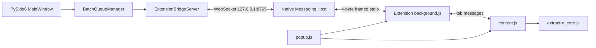

# Active Architecture

This document describes the only active runtime architecture. Historical Playwright/CDP extraction, direct Chrome WebSockets, and alternate batch protocols are not part of the application.

## System boundary

There is one active Shopee extraction implementation: `chrome_extension/extractor_core.js`. Python does not extract Shopee HTML, and the popup/background layers do not implement gallery algorithms.

## Automatic desktop flow

When the user pastes URLs and clicks **Bắt đầu tải ảnh**, the exact call path is:

1. `shopee_image_downloader.main.main()` creates `MainWindow`.
2. `MainWindow.handle_start_validation()` validates the output folder and calls `parse_url_lines()`.
3. It initializes table rows and calls `BatchQueueManager.start_batch()`.
4. `BatchQueueManager._process_current_item()` emits `item_started` and `send_open_product_requested` for exactly one item.
5. `MainWindow._on_queue_send_open_product()` creates the sole `open_product` command with `create_open_product_message()` and calls `ExtensionBridgeServer.send_message()`.
6. `ExtensionBridgeServer` sends the JSON text frame to the connected Native Host over the localhost WebSocket.
7. `NativeMessagingHost._on_ws_message_received()` relays the command to Chrome using Native Messaging framing.
8. `background.js` receives `open_product` in `handleNativeMessage()` and calls `handleOpenProductRequest()`.
9. `ensureActiveWorkerTab()` creates or reuses one foreground worker tab and navigates to the requested URL.
10. Chrome injects `extractor_core.js`, followed by `content.js`, as declared by `manifest.json`.
11. `content.js` calls `runProductExtractionLifecycle()`, which invokes `ShopeeExtractorCore.extractProductData()`.
12. A complete extraction is normalized by `buildProductSnapshot()` and emitted as `AUTHORITATIVE_PRODUCT_COMPLETE`.
13. `background.js` correlates the worker tab, product key, and request ID, then calls the only final-result builder, `sendCompleteProductToDesktop()`.
14. The `product_result` crosses Native Messaging, the Native Host WebSocket relay, `ExtensionBridgeServer._on_text_message()`, and `parse_bridge_product_data()`.
15. `MainWindow._on_bridge_product_received()` hands correlated batch data to `BatchQueueManager.handle_product_result()`.
16. The queue emits `item_completed`; `MainWindow._on_queue_item_completed()` updates the row once. The queue advances or finishes.

This is the single automatic batch flow. There is no `process_url` alias and no polling-based `RUN_FULL_SCAN` path.

## Manual extension flow

1. `popup.js:init()` locates the active Shopee tab.
2. `performExtraction()` sends `EXTRACT_PRODUCT_DATA` to `content.js`.
3. `content.js` calls `ShopeeExtractorCore.extractProductData()` and returns the display result to the popup.
4. **Kết nối Desktop** sends `CONNECT_DESKTOP` to `background.js`, which calls `chrome.runtime.connectNative()` and sends `connect_desktop` to the Native Host.
5. **Gửi sang ứng dụng** sends only the active tab ID and URL to `background.js`; it does not send a reconstructed product payload.
6. `background.js` requests `GET_COMPLETE_SNAPSHOT` from `content.js`.
7. `content.js:getCompleteSnapshotRPC()` returns its authoritative cached snapshot or invokes the same extractor core if required.
8. `background.js` calls the same `sendCompleteProductToDesktop()` used by the automatic path.
9. The result crosses the Native Host and desktop bridge. With no active correlated batch request, `MainWindow._on_bridge_product_received()` inserts or updates the row by `shop_id:item_id`.

## Component responsibilities

| Component | Owns | Must not own |
|---|---|---|
| `MainWindow` | User input, folder selection, result presentation, signal wiring | Shopee extraction, blocking network calls |
| `BatchQueueManager` | FIFO state, request correlation, timeout, verification pause/resume, cancellation | Browser/tab control, DOM extraction |
| `ExtensionBridgeServer` | Loopback WebSocket lifecycle, inbound validation, Qt signals | Shopee business extraction |
| Native Host | Native Messaging framing and localhost relay | Product construction, extraction, queue policy |
| `background.js` | Native connection, worker tab, correlation, timeout, canonical outbound product message | DOM/gallery extraction |
| `content.js` | Page lifecycle and extraction RPC boundary | Native transport, independent extractor |
| `extractor_core.js` | All Shopee product and gallery extraction | Desktop/native transport |
| `popup.js` | Manual UI and user actions | Authoritative product construction, direct extraction algorithm |

## Message ownership

| Message | Producer / owner | Consumer |
|---|---|---|
| `CONNECT_DESKTOP` | Popup | Background service worker |
| `GET_BRIDGE_STATUS` | Popup | Background service worker |
| `BRIDGE_STATUS_CHANGED` | Background service worker | Popup |
| `EXTRACT_PRODUCT_DATA` | Popup | Content script |
| `GET_COMPLETE_SNAPSHOT` | Background service worker | Content script |
| `AUTHORITATIVE_PRODUCT_COMPLETE` | Content script | Background service worker |
| `SEND_PRODUCT_TO_DESKTOP` | Popup | Background service worker |
| `connect_desktop` | Background service worker | Native Host |
| `bridge_status` | Native Host | Background service worker |
| `hello` | Native Host WebSocket client | Desktop bridge server |
| `hello_ack` | Desktop bridge server | Native Host |
| `open_product` | Desktop queue/UI | Background service worker |
| `process_progress` | Background service worker | Desktop queue |
| `process_error` | Background service worker | Desktop queue |
| `product_result` | `sendCompleteProductToDesktop()` | Desktop bridge/UI |
| `product_result_ack` | Desktop bridge server | Background service worker |
| `cancel_processing` | Desktop queue/UI | Background service worker |
| `batch_finished` | Desktop UI | Background service worker |
| `error` | Native Host or desktop validation boundary | Background service worker |

The Native Host relays messages between the two transport boundaries but does not rebuild or interpret product data.

## Storage and concurrency

`SettingsManager` persists only the selected output folder. The desktop has no active image-download or Shopee HTTP extraction worker. Browser work occurs in Chrome; desktop transport is event-driven through Qt WebSockets and signals, so the Qt GUI thread does not perform blocking network I/O.

## Required generated runtime artifact

`native_host/dist/shopee_native_host.exe` is a generated PyInstaller artifact but may be the executable referenced by the installed Native Messaging manifest. It is intentionally preserved. `native_host/shopee_native_host.spec` and the build/install/uninstall scripts are also preserved.
