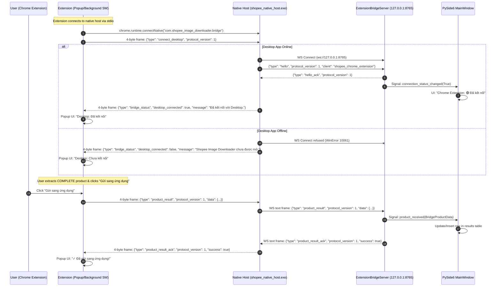

# Task 006N Specification: Chrome Native Messaging Bridge

## 1. Goal

Migrate the Chrome Extension ↔ Desktop communication transport from direct Chrome-side WebSockets (`ws://127.0.0.1:8765`) to **Chrome Native Messaging** (`com.shopee_image_downloader.bridge` stdio) connecting to a dedicated Native Host executable (`shopee_native_host.exe`), which in turn relays messages to the loopback WebSocket server (`127.0.0.1:8765`) in the PySide6 desktop application.

### Why This Migration Is Required
When Chrome extensions connect directly to a localhost WebSocket (`new WebSocket("ws://127.0.0.1:8765")`) while the desktop app is offline, Chrome's internal network stack logs:
```
WebSocket connection failed: net::ERR_CONNECTION_REFUSED
```
in DevTools and the extensions management console. This is browser-level network logging that cannot be suppressed or hidden in JavaScript.

By routing communication through **Chrome Native Messaging**, Chrome communicates solely via stdio frames with the local native host executable. The native host handles connecting to the desktop app on loopback interface:
- If the desktop app is offline, the native host catches `ConnectionRefusedError` internally without Chrome reporting any network errors, and cleanly reports `{ "type": "bridge_status", "desktop_connected": false }` to the extension.
- If the desktop app is online, the native host connects, performs handshake, and forwards product extraction data to the PySide6 UI.

---

## 2. Communication Architecture



---

## 3. Protocol & Framing Specifications

### 3.1 Chrome Native Messaging Framing (stdio)
- **Header**: 4-byte native-endian (little-endian on x86/x64 Windows) unsigned 32-bit integer representing the byte length of the following UTF-8 JSON message.
- **Payload**: UTF-8 encoded JSON object.
- **Max Message Size**: 5 MB safety limit.
- **Stream Rules**:
  - `sys.stdin.buffer` and `sys.stdout.buffer` explicitly set to binary mode.
  - `stdout` is reserved strictly for framed native messages. Absolutely zero unformatted `print()` output.
  - Diagnostics and logs are written exclusively to `%LOCALAPPDATA%\ShopeeImageDownloader\logs\native_host.log`.

### 3.2 Loopback WebSocket Protocol (RFC 6455)
- **Host**: `127.0.0.1` (Strict loopback only).
- **Port**: `8765`.
- **Client Implementation**: Standard-library lightweight RFC 6455 client (`native_host/ws_client.py`) with zero third-party dependencies for standalone binary packaging.

---

## 4. Components & File Structure

```
native_host/
├── host.py                                       # Native host entry point & message relay
├── ws_client.py                                  # RFC 6455 WebSocket client (pure stdlib)
├── com.shopee_image_downloader.bridge.json.template # Manifest template
├── com.shopee_image_downloader.bridge.json       # Generated manifest pointing to dist/
├── build_host.ps1                                # Standalone EXE build script (PyInstaller)
├── install_host.ps1                              # User registry registration script (HKCU only)
├── uninstall_host.ps1                            # User registry removal script (HKCU only)
├── README.md                                     # Usage and build instructions
└── dist/
    └── shopee_native_host.exe                    # Standalone executable
```

---

## 5. Security & Safety Boundaries

1. **Windows Registry Safety**:
   - Registered key: ONLY `HKCU\Software\Google\Chrome\NativeMessagingHosts\com.shopee_image_downloader.bridge`.
   - Never accesses or modifies `HKLM`, `HKCR`, or `HKU`.
   - No administrator privileges required.
   - Scripts are executed manually by the user, never automatically by automated agents.
2. **Origin Validation**:
   - `allowed_origins` in host manifest strictly set to `chrome-extension://kjkgdknadhnpigglcpjbgkkbcngclhgf/`.
   - No wildcard origins permitted.
3. **Loopback Only**:
   - Native host connects only to `127.0.0.1:8765`.
4. **Zero Personal Data Access**:
   - Never touches `User Data` or personal Chrome profile directories.
5. **No Direct Extension WebSockets**:
   - Zero active `new WebSocket(` calls exist across all extension source files.

---

## 6. Verification & Test Plan

1. **Framing Tests**: Verification of 4-byte length packing, unpacking, chunked stream reads, and oversize rejection.
2. **Offline & Online Resilience**: Confirmation of graceful status response when desktop is closed and successful handshake when desktop is online.
3. **Data Integrity & Deduplication**: Ensuring product names, shop IDs, item IDs, and images are accurately relayed and deduplicated in the desktop table.
4. **Static Code Inspections**: Validation that zero direct WebSockets exist in extension code and PowerShell scripts strictly target HKCU.
