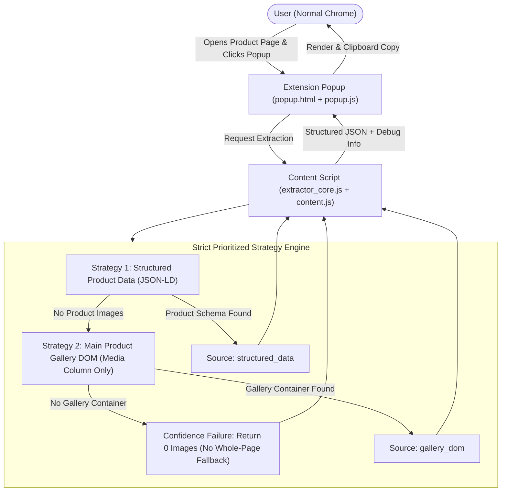

# Task 006X Specification: Chrome Extension Shopee Extraction Spike (Strict Gallery Isolation)

## 1. Goal

Prove whether a standard Chrome Extension (Manifest V3), manually loaded into a normal Google Chrome profile (e.g. `Profile 10` - `Thi Dieu Linh Tran`), can reliably extract Shopee product information and **strictly isolate the main product image gallery** from a product page that the user has manually opened and authenticated.

This task is an **isolated feasibility spike**. It does **NOT** automate Chrome, does **NOT** touch personal Chrome profile files, and does **NOT** integrate with the PySide6 desktop application yet.

---

## 2. Architecture & Extraction Flow



### Core Architecture Principles
1. **Zero Whole-Page Fallback**: The extension **NEVER** executes whole-page scans (such as `document.querySelectorAll("img")`) with heuristic filtering. If the main product gallery cannot be confidently isolated, it returns 0 images.
2. **Main Gallery vs. Variations**: Images are strictly defined as items belonging to the main Shopee product gallery shown adjacent to the product title/price area. Separate variation swatch images are excluded unless already present in the main gallery.
3. **Video Thumbnail Exclusion**: Video play button overlays and video posters are excluded from being treated as extra product images.
4. **Source Attribution & Debug Metadata**: Each extraction records its exact source (`structured_data`, `gallery_dom`, or `none`) and raw candidate counts.

---

## 3. Files Structure

```
chrome_extension/
├── manifest.json
├── popup.html
├── popup.js
├── content.js
├── extractor_core.js
└── README.md
```

---

## 4. Permissions & Minimum Scope

| Permission | Justification |
|------------|---------------|
| `activeTab` | Access the currently active tab when the user explicitly clicks the extension popup. |
| `scripting` | Programmatically inject or communicate with content scripts if needed on the active tab. |
| `host_permissions` | Strictly scoped to Shopee regional domains (`*://*.shopee.vn/*`, `*://*.shopee.com/*`, `*://*.shopee.sg/*`, `*://*.shopee.co.id/*`, `*://*.shopee.co.th/*`, `*://*.shopee.ph/*`, `*://*.shopee.my/*`, `*://*.shopee.com.br/*`, `*://*.shopee.tw/*`). |

### Prohibited Permissions (Enforced):
- `<all_urls>` (Prohibited)
- `debugger` / CDP (Prohibited)
- `cookies` (Prohibited)
- `history` (Prohibited)
- `management` (Prohibited)
- `nativeMessaging` (Prohibited)

---

## 5. Security & Isolation Boundaries

1. **Zero Access to Personal Chrome Files**:
   - The extension build and test scripts **NEVER** read, write, copy, or open files under `C:\Users\khong\AppData\Local\Google\Chrome\User Data\Profile 10` or any other personal profile directory.
2. **No Browser Automation / Fingerprint Tampering**:
   - No Playwright, Selenium, Puppeteer, or Chrome DevTools Protocol (CDP).
   - No `navigator.webdriver` tampering, stealth plugins, proxy rotation, or CAPTCHA solving bypasses.
   - If Shopee prompts for human verification, the user solves it manually in the normal browser.
3. **Frozen Legacy Tasks (006 / 006A)**:
   - Existing Playwright/CDP modules (`browser_session.py`, `auth_worker.py`, `metadata_extractor.py`, etc.) are left completely unmodified.
4. **No Desktop App Integration in 006X**:
   - No WebSockets, localhost servers, native messaging, file writing, or image downloading in this spike.

---

## 6. Confirmed Shopee DOM Structure & Button-Driven Carousel Strategy

### Confirmed Shopee Gallery DOM Architecture
Shopee's product gallery thumbnail carousel is **NOT a scroll container** (`scrollWidth == clientWidth`, `scrollHeight == clientHeight`, `overflow == visible`). Instead, Shopee rotates/paginates thumbnails dynamically using left/right arrow buttons:

- **Gallery Container**: `<div class="Wi_1Rq">` (or container with `.qIctnQ` children and carousel buttons).
- **Media Thumbnail Item**: `<div class="qIctnQ">` containing `.mdCA_C` -> `.FAWPL0` -> `<picture>` -> ``.
  - `img.src` is the plain high-resolution Shopee image URL (`https://down-vn.img.susercontent.com/file/<ASSET_ID>`).
- **Video Indicator**: `` inside `.mdCA_C`.
- **Right Arrow Button**: `<button class="shopee-icon-button ... mARMpd"></button>`.
- **Left Arrow Button**: `<button class="shopee-icon-button ... UTST3I"></button>`.

### Button-Driven Carousel Enumeration (`enumerateCompleteGallery`)
1. **Initial Capture**: Collects currently visible thumbnail items (`.qIctnQ`) in the carousel viewport (typically ~5 items).
2. **Media Classification (`classifyGalleryMediaItem`)**:
   - `VIDEO`: Contains `img[alt*="video play" i]`, `img.emXGWZ`, `<video>`, or duration indicators (`0:30`). Video posters are strictly excluded from `images[]`.
   - `IMAGE`: Contains `img` / `<picture>` / background image.
   - `UNKNOWN`: Other non-image elements.
3. **Carousel Advancement (`advanceCarousel`)**:
   - Finds right arrow button (`button img[alt*="arrow right bold" i]`, `button.mARMpd`).
   - If clickable and not disabled, triggers click to advance carousel.
   - Bounded delay (50–60ms) to allow Shopee DOM to render next thumbnail window.
   - Collects newly exposed `.qIctnQ` items and records them in memory preserving first-seen gallery order.
   - Handles overlapping windows (e.g. `[A,B,C,D,E]` -> `[B,C,D,E,F]` -> `[C,D,E,F,G]` -> `A,B,C,D,E,F,G`).
   - Terminates when advancing produces no new items, right button becomes disabled, or safety cap is reached.

### Source Priority & Arbitration (`chooseBestImageSource`)
- **Main Gallery Carousel (`gallery_carousel`)**: Preferred primary source whenever the main gallery carousel is confidently identified and yields images.
- **Structured Product Data (`structured_data`)**: Secondary fallback when JSON-LD contains multiple valid images (`>= 2`).
- **Structured Single-Image Fallback (`structured_single_fallback`)**: Used when structured data contains exactly 1 cover photo and carousel yields 0.
- **None (`none`)**: Failure with 0 images and `"Không thể xác định chính xác bộ ảnh sản phẩm."`. (Zero whole-page scanning fallback).

---

## 7. Manual Installation Guide

1. Open normal Google Chrome.
2. In the address bar, navigate to: `chrome://extensions`
3. Enable **Developer mode** (toggle switch in the top-right corner).
4. Click **Load unpacked** (Tải tiện ích đã giải nén).
5. Select the folder: `D:\download-picture-shopee\chrome_extension`
6. Pin the "Shopee Product Extractor" extension icon to the Chrome toolbar for quick access.

---

## 8. Manual Testing Procedure

1. In normal Chrome (with user profile `Thi Dieu Linh Tran`), navigate to a Shopee product page (e.g. `https://shopee.vn/...`).
2. Log into Shopee normally if required; solve any Shopee verification challenge manually if presented.
3. Once the product page is fully loaded, click the **Shopee Product Extractor** icon in the toolbar.
4. Verify that the popup displays:
   - **Product Name** matching the page.
   - **Shop ID** and **Item ID** matching the listing.
   - **Diagnostic metrics**:
     - `Structured candidates: X`
     - `Initial visible gallery media: X`
     - `Carousel advances: X`
     - `Total unique gallery media discovered: X`
     - `Image media: X`
     - `Video media: X`
     - `Unknown media: X`
     - `Selected source: Main Gallery Carousel`
     - `Final images: X`
   - Gallery image previews displaying only genuine product photos (excluding video thumbnails).
5. Click **[Copy Result]** / **[Sao chép kết quả (JSON)]**.
6. Paste into a text editor and verify the structured JSON:
   ```json
   {
     "url": "https://shopee.vn/...",
     "product_name": "Tên sản phẩm...",
     "shop_id": "12345678",
     "item_id": "987654321",
     "images": [
       "https://down-vn.img.susercontent.com/file/vn-...",
       "https://down-vn.img.susercontent.com/file/vn-..."
     ],
     "image_source": "gallery_carousel",
     "debug": {
       "structured_candidates": 1,
       "initial_visible_gallery_media": 5,
       "carousel_advances": 3,
       "total_unique_gallery_media": 10,
       "image_media": 9,
       "video_media": 1,
       "unknown_media": 0,
       "selected_source": "gallery_carousel",
       "selected_source_label": "Main Gallery Carousel",
       "final_images": 9
     }
   }
   ```
7. Navigate to a non-Shopee page (e.g., `https://google.com`), open the popup, and verify:
   `"Đây không phải trang sản phẩm Shopee."`

---

## 9. PASS / FAIL Criteria

### PASS Criteria
- [x] Extension loads cleanly in Chrome Manifest V3 with 0 errors/warnings on `chrome://extensions`.
- [x] On an active Shopee product page, extracts only the main product gallery:
  - Correct Product Name, Shop ID, Item ID
  - Image Count matches actual gallery photos
  - Zero logos, shop avatars, banners, review images, or recommendation products
- [x] Clear debug indicators (`Image source`, `Raw candidates`, `Deduplicated count`).
- [x] Returns 0 images and displays `"Không thể xác định chính xác bộ ảnh sản phẩm."` if gallery cannot be confidently isolated.
- [x] [Copy Result] copies valid structured JSON to clipboard.
- [x] Non-Shopee tabs show `"Đây không phải trang sản phẩm Shopee."`.
- [x] Zero access to user's personal Chrome profile files on disk.
- [x] Legacy Task 006 / 006A codebase remains frozen and untampered.

### FAIL Criteria
- Collects unrelated page images (shop logos, banners, size charts, recommendations, review photos).
- Scans `document.querySelectorAll("img")` across the whole page.
- Requires invasive permissions (`<all_urls>`, `debugger`, `cookies`, `nativeMessaging`).
- Attempts automated browser control or CAPTCHA bypass.
