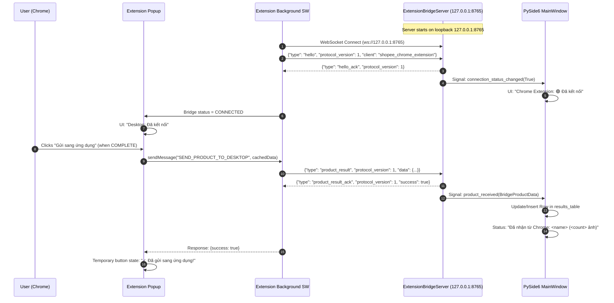

# Task 006Y Specification: Chrome Extension ↔ PySide6 Desktop Bridge

## 1. Goal

Establish a robust, secure, local loopback WebSocket communication bridge connecting the authenticated **Shopee Chrome Extension** (from Task 006X) to the **PySide6 desktop application**.

The single objective of Task 006Y is:
1. User views complete Shopee product extraction in the Chrome Extension popup.
2. User clicks **"Gửi sang ứng dụng"** in the extension popup.
3. Chrome Extension sends the authoritative cached `COMPLETE` product result to the desktop app over WebSocket (`ws://127.0.0.1:8765`).
4. PySide6 Desktop App receives the product data via Qt signals without blocking the GUI thread.
5. Desktop UI displays the product in its results table:
   - **Sản phẩm / Link**: Product Name
   - **Trạng thái**: `Đã nhận từ Chrome`
   - **Số ảnh**: `images.length`

Task 006Y does **NOT** implement automatic URL navigation, automatic tab opening, or automatic image downloading/folder writing yet.

---

## 2. Communication Architecture



---

## 3. Protocol Specification

### Protocol Version
Current protocol version is `1`.

### Endpoints
- **Host**: `127.0.0.1` (Strict loopback only; rejects `0.0.0.0`, LAN, and public network bindings).
- **Default Port**: `8765` (Configurable via `DEFAULT_BRIDGE_PORT`).

### Message Types

#### 1. Handshake (`hello` / `hello_ack`)
**Client -> Desktop**:
```json
{
  "type": "hello",
  "protocol_version": 1,
  "client": "shopee_chrome_extension"
}
```

**Desktop -> Client**:
```json
{
  "type": "hello_ack",
  "protocol_version": 1
}
```

#### 2. Product Transmission (`product_result` / `product_result_ack`)
**Client -> Desktop**:
```json
{
  "type": "product_result",
  "protocol_version": 1,
  "data": {
    "url": "https://shopee.vn/product-listing-url...",
    "product_name": "Tên sản phẩm Shopee chính hãng",
    "shop_id": "12345678",
    "item_id": "987654321",
    "images": [
      "https://down-vn.img.susercontent.com/file/vn-...",
      "https://down-vn.img.susercontent.com/file/vn-..."
    ]
  }
}
```

**Desktop -> Client**:
```json
{
  "type": "product_result_ack",
  "protocol_version": 1,
  "success": true,
  "message": "Đã nhận thành công"
}
```

#### 3. Error Response (`error`)
```json
{
  "type": "error",
  "protocol_version": 1,
  "error": "Mô tả chi tiết lỗi xác thực hoặc cú pháp"
}
```

---

## 4. UI & State Management

### Connection State Machine
The bridge connection manages discrete states with **zero automatic WebSocket connections or background retry loops**:
- `DISCONNECTED`: Desktop bridge is not connected or desktop app is closed.
  - **Popup UI (Initial)**: `Desktop: Chưa kết nối` (neutral/red badge) + visible `[Kết nối ứng dụng]` button.
  - **Popup UI (After Connection Loss)**: `Desktop: Mất kết nối` (neutral/red badge) + visible `[Kết nối lại]` button.
  - **Action Guard**: `[Gửi sang ứng dụng]` is disabled with tooltip *"Vui lòng kết nối ứng dụng trước."*.
- `CONNECTING`: User-initiated connection attempt actively in progress.
  - **Popup UI**: `Desktop: Đang kết nối...` (amber badge) + disabled `[Đang kết nối...]` button.
  - **Action Guard**: `[Gửi sang ứng dụng]` is disabled.
- `CONNECTED`: Handshake `hello` -> `hello_ack` succeeded.
  - **Popup UI**: `Desktop: Đã kết nối` (green badge). Connect button hidden.
  - **Action Guard**: `[Gửi sang ứng dụng]` enabled when gallery extraction is `COMPLETE`.

### 100% User-Initiated Connection Lifecycle (Zero Idle Sockets)
- **Zero WebSocket Attempts While Idle**: The following actions produce exactly 0 WebSocket connection attempts:
  - Extension reload / service worker boot
  - Starting Chrome / navigating Shopee
  - Opening / closing extension popup
  - Scanning product gallery / thumbnail clicks
- **Manual Initiation**: WebSocket is created **ONLY** upon explicit user click on `[Kết nối ứng dụng]` / `[Kết nối lại]`.
- **Clean Failure & Disconnection**:
  - If the desktop app is offline when clicked, the socket closes and immediately returns to `DISCONNECTED` with *"Không tìm thấy ứng dụng. Hãy mở Shopee Image Downloader trước."*.
  - If a connected socket closes, it immediately transitions to `DISCONNECTED` (`Mất kết nối`) with **0 background retry timers**. The user reconnects by clicking `[Kết nối lại]`.


### PySide6 Desktop Application
- **Bridge Status Area**:
  - Initial / Not Connected: `Chrome Extension: 🔴 Chưa kết nối`
  - Connected: `Chrome Extension: 🟢 Đã kết nối`
  - Disconnected after previous connection: `Chrome Extension: 🔴 Mất kết nối`
- **Results Table Display**:
  - `STT`: Row index (1-indexed, centered)
  - `Sản phẩm / Link`: `product_name`
  - `Trạng thái`: `Đã nhận từ Chrome`
  - `Số ảnh`: `images.length`
  - Tooltips: Formatted breakdown with `product_name`, `shop_id`, `item_id`, `url`, and `images` count.
- **Deduplication Behavior**:
  - Keyed by `product_key = f"{shop_id}:{item_id}"`.
  - If the same product is sent repeatedly, the existing row is updated in-place.
  - Distinct `item_id`s append new independent rows.

---

## 5. Security & Error Safety Boundaries

1. **Loopback Only**: Server binds strictly to `127.0.0.1` and actively validates loopback address before opening port.
2. **Zero Uncaught Boot Errors on `chrome://extensions`**:
   - Background service worker starts cleanly in `DISCONNECTED` state on load.
   - Desktop application being unavailable is treated as a normal state, not an unhandled exception.
   - All `chrome.runtime.sendMessage` callbacks check `chrome.runtime.lastError` to prevent unhandled port closure warnings.
   - `onMessage` listeners return `false` on synchronous responses.
3. **Zero Insecure Code Execution**: Incoming JSON is strictly validated against schemas. Strings are never executed or passed to shell commands.
4. **No File System Access**: Chrome Extension touches only its sandboxed storage and APIs. No disk access to user profile directories.
5. **Minimal Permissions**: No invasive Chrome permissions added (`<all_urls>`, `debugger`, `cookies`, `nativeMessaging` remain strictly prohibited).
6. **Frozen Legacy Modules**: Legacy Task 006/006A Playwright code remains completely intact and untouched.

