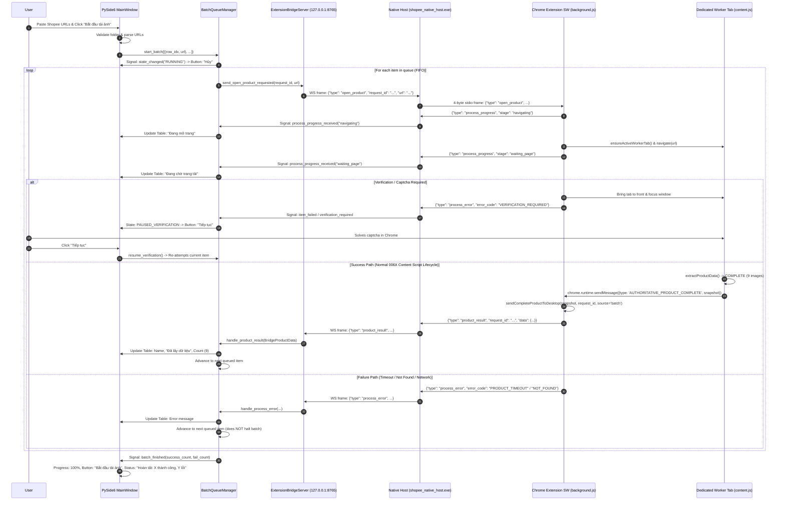

# Task 006Z Specification: Desktop Batch URL Queue → Chrome Extension Worker

## 1. Goal

Implement the simplified, robust end-to-end batch workflow connecting the PySide6 desktop application to the Chrome Extension background service worker:
1. User pastes multiple Shopee product URLs into the PySide6 desktop application.
2. User clicks **"Bắt đầu tải ảnh"**.
3. Desktop builds a sequential FIFO batch queue (`BatchQueueManager`).
4. Native Messaging bridge transmits an `open_product` command (**ONE URL at a time**) to the Chrome Extension.
5. Chrome Extension opens/navigates **ONE dedicated worker tab** in the foreground.
6. The dedicated worker tab executes the proven **Task 006X Content Script lifecycle** (`extractor_core.js` + `content.js`).
7. When the content script achieves proof of `COMPLETE`, it emits `AUTHORITATIVE_PRODUCT_COMPLETE` with the authoritative snapshot.
8. Background service worker correlates the event to the active `request_id` and dispatches it via the canonical shared sender `sendCompleteProductToDesktop()`.
9. Desktop updates the table in-place (matched by `request_id` or `product_key`), advances to the next item until all URLs are processed, and presents the final summary.

> [!NOTE]
> This task focuses exclusively on URL extraction and batch orchestration. Actual image file downloading and folder saving to disk are reserved for Task 007.

---

## 2. End-to-End Sequence Diagram

---

## 3. Key Design Principles & Guarantees

### 3.1 Desktop Owns the Queue
- The PySide6 desktop application is the single authority managing the queue state machine (`QueueState`: `IDLE`, `RUNNING`, `PAUSED_VERIFICATION`, `CANCELLING`).
- Desktop sends `OPEN_PRODUCT` commands sequentially (**one URL in-flight at any time**).
- Requests carry a unique `request_id = "req-<uuid>"`. Results or errors with mismatched or stale `request_id` values are discarded safely.

### 3.2 Single Dedicated Foreground Worker Tab Lifecycle
- **Foreground Mode & Activation Before Navigation**:
  - The worker tab is created/updated with `active: true` and its window is explicitly focused with `chrome.windows.update(workerTab.windowId, { focused: true })` **before** navigation begins.
  - This ensures Shopee's React / SPA rendering engine hydrates the DOM without background throttling.
- **Whole-Batch Tab Retention**:
  - The worker tab remains active for all items in the batch (`product 1`, `product 2`, `product 3`, ...), avoiding focus flickering.
- **Original User Tab Restoration**:
  - Before the batch begins, `originalUserTabId` and `originalUserWindowId` are recorded.
  - Upon batch completion (`batch_finished`), cancellation (`cancel_processing`), or connection termination, the dedicated worker tab is cleanly closed and the user's original tab and window are restored without closing unrelated user tabs.

### 3.3 Event-Driven Extraction via Proven 006X Content Script Lifecycle
- **Zero Duplicated Extraction in Orchestrator**:
  - `background.js` acts strictly as an **orchestrator** and never extracts product name, images, or gallery media independently from the DOM.
  - The content script (`content.js` + `extractor_core.js`) automatically executes the proven 006X lifecycle on page load and DOM idle.
  - When extraction reaches `COMPLETE` with valid bounds confirmation (`CAROUSEL_BOUNDS_CONFIRMED` or `STABLE_SINGLE_PAGE`), `content.js` broadcasts `AUTHORITATIVE_PRODUCT_COMPLETE` containing the authoritative snapshot.
- **Request State Machine & Exactly-Once Auto-Send**:
  - `background.js` tracks request states (`IDLE`, `OPENING`, `WAITING_COMPLETE`, `SENT`, `FAILED`).
  - When `AUTHORITATIVE_PRODUCT_COMPLETE` arrives matching the active worker tab and `currentRequestId`, `background.js` dispatches the product result exactly once and transitions state to `SENT`.
  - Duplicate events or stale product key events are safely ignored.
- **Bounded Per-Product Timeout**:
  - Each `open_product` navigation is protected by a 35-second bounded timer (`PRODUCT_TIMEOUT_MS = 35000`).
  - If no complete snapshot arrives before timeout, `background.js` emits `process_error` with `PRODUCT_TIMEOUT`, allowing the queue to proceed to subsequent items resiliently.

### 3.4 Verification & CAPTCHA Protocol
- When Shopee redirects the worker tab to `/verify/captcha` or `/verify/traffic/error`:
  1. Extension brings the worker tab to front and focuses the Chrome window.
  2. Extension transmits `error_code: "VERIFICATION_REQUIRED"` to Desktop.
  3. Desktop pauses the batch (`PAUSED_VERIFICATION`), sets row status to `"Shopee yêu cầu xác minh"`, and updates the main button to **"Tiếp tục"**.
  4. Once resolved, clicking **"Tiếp tục"** re-dispatches the current item without skipping it.

### 3.5 Cancellation Protocol
- Clicking **"Hủy"** during an active batch transitions state to `IDLE`, transmits `cancel_processing` to the Extension, cancels the current in-flight item, marks it as `"Đã hủy"`, closes the dedicated worker tab, restores the user's original tab, and halts queue progression.

### 3.6 Single Canonical Sender Function (`sendCompleteProductToDesktop`)
- **Single Canonical Implementation**:
  - Both manual user dispatch (Extension Popup `"Gửi sang ứng dụng"`) and automated batch completion call the exact same underlying function: `sendCompleteProductToDesktop({ snapshot, requestId, inputUrl, source })`.
  - There is strictly **ONE** active location in the Chrome Extension constructing the `type: "product_result"` message.
- **Desktop In-Place Table Matching & Deduplication**:
  - `MainWindow` maintains `_rows_by_request_id: dict[str, int]` and `_rows_by_product_key: dict[str, int]`.
  - When batch runs, rows are indexed by `request_id`.
  - When batch completes or when a subsequent manual send arrives (`request_id = None`), `_on_bridge_product_received` resolves existing rows by `request_id` or `product_key`, updating table cells in place and preventing duplicate row insertion.

